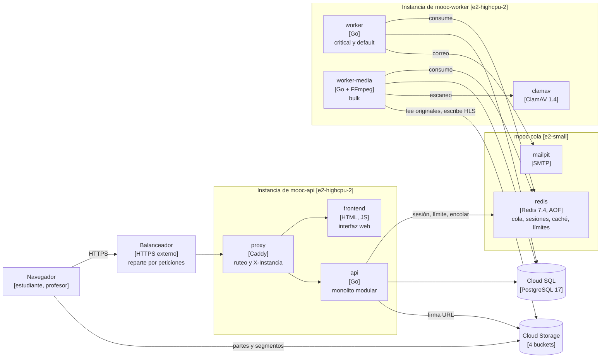
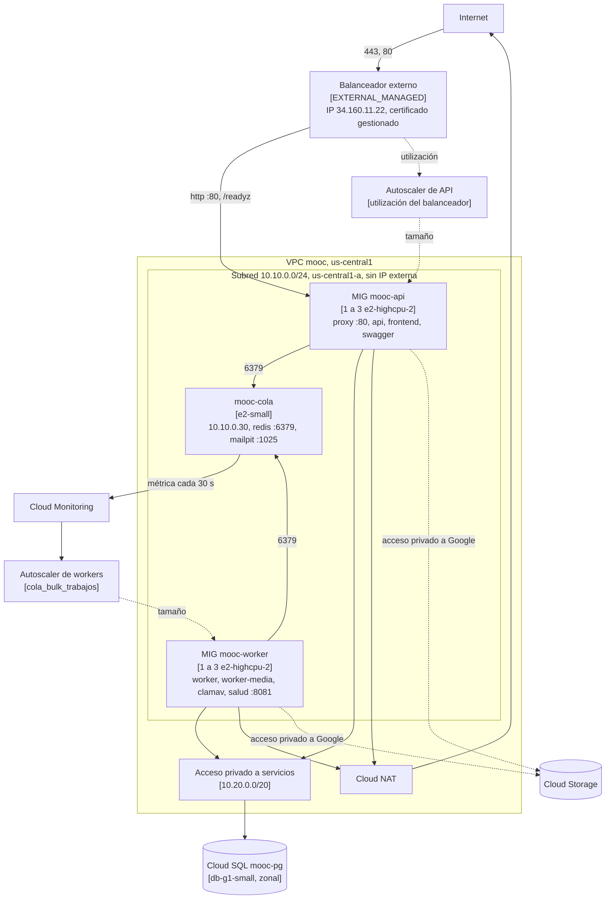

# Informe de arquitectura. Entrega 3

Santiago Chica Castano, Josue Briceño Urquijo, Daniel Alfredo Reales Paba y
Michael Javier Patiño Pantoja.

URL pública `https://34-160-11-22.sslip.io`, la misma para la interfaz web, la
API (`/api/v1`) y su documentación (`/docs`).

## Qué cambió desde la Entrega 2

Las dos máquinas fijas pasan a dos grupos de instancias que escalan solos, uno
de API y otro de workers, detrás de un balanceador HTTPS. Redis sale del
Worker Server a una máquina propia, fuera de los grupos. La interfaz web se
despliega junto a la API. El código nuevo es el que exige la elasticidad:
migraciones serializadas entre réplicas, una cola que no duplica trabajos,
apagado ordenado de los workers y verificaciones de salud sin datos internos.

## 1. Introducción y objetivos

El objetivo es que la capacidad de la API y del procesamiento asíncrono siga a
la demanda sin intervención, sin perder estado de negocio al crear o retirar
instancias, y medir el efecto frente a la línea base de la Entrega 2.

### Alcance de esta entrega

| Área | Qué se entrega |
| --- | --- |
| Cómputo | Grupos `mooc-api` y `mooc-worker`, de 1 a 3 instancias, con autoscaler y autorreparación |
| Entrada | Balanceador de aplicaciones externo con certificado gestionado |
| Cola | `mooc-cola`, una máquina con Redis y Mailpit fuera de los grupos |
| Interfaz | Recorridos de estudiante y profesor servidos desde el grupo de API |
| Datos | Cloud SQL y Cloud Storage de la Entrega 2, sin recrearse |
| Calidad | SonarQube en el CI y primera línea base de deuda técnica |

### Contenido del documento

| Contenido | Sección |
| --- | --- |
| Modelo de componentes | 5 y 6 |
| Modelo de despliegue | 7 |
| Decisiones de escalamiento | 8 y 9 |
| Operación y recuperación | 8 |
| Capacidad, costo y limitaciones | 10 y 11 |

## 2. Restricciones

| Restricción | Consecuencia |
| --- | --- |
| Dos grupos independientes de 1 a 3 instancias | Un autoscaler por grupo, con señal propia |
| Escalado horizontal de los workers | La concurrencia por instancia no cambia. Crece el número de instancias |
| Cola compartida fuera de los grupos | Redis en `mooc-cola`, que ningún autoscaler puede retirar |
| Instancias que arrancan solas | Plantilla con script de arranque e imagen horneada |
| Sin CDN, multizona, failover ni Kubernetes | Grupos zonales y Cloud SQL zonal |
| Mismo tipo de máquina que la Entrega 2 | `e2-highcpu-2` en los dos grupos, para comparar por instancia |
| Ningún secreto en código, plantillas ni imágenes | Secret Manager, leído por cada instancia al arrancar |

## 3. Contexto y alcance

Estudiantes, profesores y administradores entran por el balanceador con el
navegador. Los archivos viajan entre el navegador y Cloud Storage con URL
firmadas. El correo lo recibe Mailpit en `mooc-cola`, sin proveedor
contratado.

## 4. Estrategia de solución

Cada instancia corre la composición de la Entrega 2 recortada a su papel. La
plantilla del grupo le entrega por metadatos la composición, la configuración
sin secretos y `deploy/arranque.sh`. El estado vive fuera de las instancias:
PostgreSQL en Cloud SQL, archivos en Cloud Storage, y sesiones y cola en
`mooc-cola`. Así cualquier instancia se crea o se retira sin coordinación. El
entorno de Terraform `infra/environments/entrega3` heredó el estado de la
Entrega 2 y no recreó la base ni los buckets.

## 5. Vista de bloques

El proxy de cada instancia manda `/api/*` y las rutas de salud a la API,
`/docs` a Swagger y el resto a la interfaz. Añade la cabecera `X-Instancia`
con el nombre de la máquina. La API
lee la sesión y el límite de tasa en Redis en cada petición autenticada, así
que dos peticiones seguidas pueden llegar a instancias distintas.

| Módulo de la API | Responsabilidad |
| --- | --- |
| `identity` y `admin` | Cuentas, sesiones, roles y administración |
| `authoring` | Jerarquía del curso y versiones inmutables |
| `learning` | Catálogo, inscripción y progreso calculado en el servidor |
| `assessment` | Quizzes, intentos y calificación |
| `media` | Carga por partes, verificación, escaneo, HLS y sesiones de reproducción |
| `badges` y `audit` | Insignias verificables y auditoría |

Lo asíncrono se registra en PostgreSQL en la misma transacción que el cambio y
se publica en Redis después del commit. Cada tarea lleva su clave de trabajo
como identificador, así que la cola no admite dos copias vivas del mismo
trabajo.

| Trabajo | Cola | Lo consume |
| --- | --- | --- |
| `email.send`, `badge.issue` | `critical` | `worker` |
| `media.probe` | `default` | `worker` |
| `media.scan`, `media.transcode_hls` | `bulk` | `worker-media` |

## 6. Vista de ejecución

Estos dos casos de la elasticidad se observaron el 24 de octubre
(`docs/entrega3/evidencias/elastica/2026-10-24-sesion-c.md`).

### Crecimiento de la API

1. La carga sube a 50 peticiones por segundo sobre una instancia.
2. A los 65 s el autoscaler crea la segunda, porque la utilización supera 0,8
   de 40 peticiones por segundo.
3. La instancia arranca desde la imagen horneada. `migrate` encuentra el
   esquema al día y la API queda lista en 19 s.
4. El balanceador la incorpora cuando pasa dos veces `/readyz`, a los 109 s de
   su creación.
5. De 200 peticiones, 95 y 105 llegan a cada instancia.

### Retiro de un worker ocupado

1. El autoscaler retira una instancia que transcodifica un video.
2. GCE ejecuta `deploy/apagado-worker.sh`, que detiene los contenedores con su
   periodo de gracia.
3. `worker-media` deja de tomar trabajos y espera al que está en curso.
4. El trabajo termina en su primer intento y la máquina se apaga 18 s después.
5. Fuera de plazo, el worker lo cortaría y otra instancia lo repetiría con la
   misma clave.

## 7. Vista de despliegue

El balanceador es la única dirección pública. Termina TLS, redirige el 80 al
443 y reparte hacia el puerto nombrado `http` del grupo de API. Ninguna
instancia tiene IP externa. Salen por Cloud NAT y llegan a Cloud SQL por el
acceso privado a servicios, y a Cloud Storage, Artifact Registry y Secret
Manager por el acceso privado a Google. Un temporizador en `mooc-cola` publica
cada 30 s los trabajos de `bulk` pendientes y en curso, que es la señal del
autoscaler de workers.

| Recurso | Configuración |
| --- | --- |
| Grupos | Zonales en `us-central1-a`, Debian 12 horneado, `pd-balanced` de 30 GiB |
| Actualización | Reemplazo de una en una, con una instancia de más y ninguna de menos |
| Balanceador | Modo `RATE`, 40 peticiones por segundo por instancia, drenaje de 30 s, sin afinidad |
| Cola | `e2-small`, disco de 20 GiB, IP interna fija |
| Base | PostgreSQL 17, `db-g1-small`, 10 GiB SSD, solo conexiones cifradas |
| Objetos | `originals`, `derived` y `quarantine` privados, `badges` de lectura pública |

### Reglas de acceso

| Regla | Origen | Destino | Puertos |
| --- | --- | --- | --- |
| `mooc-lb-api` | Rangos del balanceador y de las verificaciones | Cuenta de API | 80 |
| `mooc-salud-worker` | Rangos de las verificaciones | Cuenta de worker | 8081 |
| `mooc-redis-interno` | Cuentas de API y de worker | Cuenta de la cola | 6379 |
| `mooc-smtp-interno` | Cuentas de API y de worker | Cuenta de la cola | 1025 |
| `mooc-ssh-iap` | Rango de IAP | Las tres cuentas | 22 |
| `mooc-denegar-resto` | Internet | Toda la VPC | Todo, con registro |

## 8. Conceptos transversales

### Plantillas y arranque

La plantilla fija tipo de máquina, imagen, disco, subred, cuenta de servicio y
metadatos. La imagen `mooc-base-<sha>` sale de `make hornear-imagen` y trae
Docker, el agente de operaciones y las imágenes de contenedor ya descargadas.
Cada instancia lleva la etiqueta `version` con el SHA de las imágenes, y
`make instancias` comprueba que todas las de un grupo ejecutan el mismo código.

`deploy/arranque.sh` es idempotente. Añade los secretos de Secret Manager en
un `.env` con permisos 0600 y levanta la composición sin duplicar contenedores. La instancia está lista
cuando la API pasa `/readyz` en el balanceador o cuando el worker toma su
primer trabajo. Con la imagen horneada, la API tardó de 53 a 80 s y el worker
de 70 a 100 s desde la máquina en marcha.

### Migraciones

Cada API corre `migrate` al arrancar. Un bloqueo consultivo de PostgreSQL
serializa las réplicas, y la que espera encuentra el esquema al día.
`make migraciones-concurrentes` lanza tres a la vez sobre una base vacía en
cada CI.

### Verificaciones de salud

| Verificación | Ruta | Intervalo y umbrales | Efecto |
| --- | --- | --- | --- |
| Preparación del balanceador | `/readyz` por el 80 | 5 s, timeout 5 s, 2 sanas, 3 fallidas | La instancia sale del reparto |
| Vida de la API | `/healthz` por el 80 | 12 s, timeout 5 s, 2 sanas, 10 fallidas | El grupo recrea la instancia |
| Vida de los workers | `/healthz` por el 8081 | 12 s, timeout 5 s, 2 sanas, 10 fallidas | El grupo recrea la instancia |

`/readyz` comprueba PostgreSQL, Redis y el almacén de objetos, y responde solo
`ok` o `fail` por dependencia. El detalle del error va al log. La exclusión y
la reparación usan verificaciones distintas porque, si cae Redis, `/readyz`
falla en todas las instancias y recrearlas no arregla nada. Una API detenida
salió del reparto a los 14 s y el grupo la recreó a los 111 s.

### Políticas de escalado

| Parámetro | API | Workers |
| --- | --- | --- |
| Señal | Utilización del balanceador | `custom.googleapis.com/mooc/cola_bulk_trabajos`, métrica de grupo |
| Objetivo | 0,8 de 40 peticiones por segundo por instancia | 2 trabajos por instancia |
| Inicialización | 120 s | 150 s |
| Reducción | Una instancia cada 600 s como máximo | Una instancia cada 600 s como máximo |
| Límites | 1 a 3 | 1 a 3 |

La API escala por peticiones porque en la Entrega 2 su CPU no pasó del 60 %
con la base saturada. El umbral de 32 peticiones por instancia queda por
debajo de las 61 a 68 que una instancia sostuvo. Los workers escalan por
trabajos de `bulk` porque FFmpeg fue el cuello de botella, y la señal cuenta
los trabajos en curso para no encoger mientras una instancia transcodifica.
La inicialización es el peor arranque medido con un margen del 50 %. Al llegar
a 3, la API acumula latencia y los workers, espera en cola.

### Retiro seguro de workers

`worker` espera 50 s y `worker-media` 280 s a los trabajos activos, con
periodos de gracia del contenedor de 60 y 300 s. A las nueve décimas del plazo
el worker corta lo que no terminó y lo deja reclamable. Un trabajo cuyo worker
desapareció sin apagarse se reclama tras 90 s sin latido. La idempotencia
impide derivados duplicados. Los nueve videos de la Sesión C tienen un solo
juego de derivados cada uno.

### Conexiones a la base

Los pools son de 8 por API y 3 por proceso de worker. Con tres instancias de
cada grupo suman 42 de las 47 conexiones útiles de `db-g1-small`. El máximo
observado con 3 + 3 fue de 27.

### Secretos e identidades

El acceso a la nube y el acceso a la base se autorizan por caminos distintos.
Cada instancia usa la cuenta de servicio de su grupo, sin clave descargada.
`mooc-web` y `mooc-worker` leen sus secretos, escriben registros y métricas, y
tienen permiso por bucket según su función. `mooc-web` firma URL con
`signBlob` sobre sí misma. `mooc-cola` solo escribe registros y métricas. La
aplicación entra a PostgreSQL con el usuario `mooc` y la contraseña del secreto
`database-url`, con `sslmode=require`. Terraform genera esa contraseña como
valor efímero y no queda en el estado.

### Interfaz web

La interfaz es un contenedor Caddy con archivos estáticos, en la misma
instancia y versión que la API. Comparte origen, así que la API no necesita
CORS. Los buckets admiten CORS solo desde la URL pública, para la carga
directa y la reproducción HLS. El token de sesión vive en `sessionStorage` y
viaja en `Authorization`.

### Operación

| Tarea | Cómo |
| --- | --- |
| Publicar | `make publicar` y `make hornear-imagen`, con el SHA en `version_imagenes` e `imagen_grupos` |
| Encender o apagar | `entorno_encendido` y `cloudsql_encendida`, con `make tf ENTORNO=entrega3` |
| Autoscaling | `autoescalado = true`. En `false` cada grupo queda fijo en una instancia |
| Verificar | `make postman-nube` por el balanceador y `make instancias` |
| Administrar | `make ssh`, por IAP con OS Login |
| Reconstruir | El orden de `arquitectura/despliegue-gcp-entrega3.md`: `apply` sin autoscaling, certificado, semilla, imagen y autoscaling |

Apagado, los grupos quedan en cero, `mooc-cola` y la base detenidas y las
reglas de reenvío borradas. La IP y el certificado se conservan y la URL no
cambia. El entorno de la Entrega 2 salió de `main` y su configuración está en
el tag `entrega-2`.

## 9. Decisiones de arquitectura

| Decisión | Motivo | Registro |
| --- | --- | --- |
| Entorno `entrega3` que hereda el estado | La base y los buckets no se recrean | ADR-0019, D1 |
| Redis en una máquina dedicada | Unos 0,45 USD al día frente a 1,2 de Memorystore | ADR-0019, D2 |
| Interfaz junto a la API | Mismo origen y misma versión que la plantilla | ADR-0017 |
| Balanceador con certificado gestionado sobre `sslip.io` | HTTPS sin comprar dominio | ADR-0019, D3 |
| Preparación y vida separadas | La caída de una dependencia no provoca recreaciones en bucle | ADR-0019, D4 |
| Señales de peticiones y de trabajos de `bulk` | Siguen los cuellos de botella medidos | ADR-0019, D5 |
| Corte antes del plazo de apagado | El trabajo cortado queda reclamable en lugar de bloqueado | ADR-0019, D6 |
| Imagen horneada antes de medir | El arranque no cambia entre corridas | ADR-0019, D7 |
| SonarQube Community en el CI | La misma versión de reglas en local y en el pipeline | ADR-0018 |

## 10. Requisitos de calidad

### Elasticidad observada

| Medida | Valor |
| --- | --- |
| De la carga a la decisión de crecer, API | 65 s |
| De la creación a recibir tráfico, API | 109 s como máximo |
| De la cola con 5 videos a dos workers nuevos | 30 a 55 s |
| De la creación a estar listo, workers | 68 a 71 s |
| Reducción | Una instancia por ventana de 10 min, de 3 a 1 en las dos capas |
| Errores al excluir una API | 2 de unas 700 peticiones |

La comparación de los escenarios de la Entrega 2 sobre esta arquitectura está
en el
[informe de capacidad](../../capacity-planning/pruebas_de_carga_entrega3.md).

### Costo

Estimación del 25 de octubre de 2026 con precios de lista de `us-central1`,
por día de 24 horas encendido.

| Recurso | 1 + 1 instancias (USD/día) | 3 + 3 instancias (USD/día) | Apagado (USD/día) |
| --- | --- | --- | --- |
| Instancias `e2-highcpu-2`, 0,0495 USD/h | 2,38 | 7,13 | 0 |
| Sus discos, 30 GiB `pd-balanced` | 0,20 | 0,60 | 0 |
| `mooc-cola`, máquina y disco | 0,47 | 0,47 | 0,07 |
| Cloud SQL, cómputo y disco | 0,90 | 0,90 | 0,06 |
| Balanceador, reglas de reenvío e IP | 0,72 | 0,72 | 0,24 |
| Cloud NAT, métricas, objetos e imágenes | 0,31 | 0,79 | 0,04 |
| **Total** | **4,98** | **10,61** | **0,41** |

La interfaz corre en las instancias de API y no suma costo. Apagado, la IP
reservada es más de la mitad del gasto. Las tres
sesiones de puesta en marcha y autoscaling sumaron unas 6 horas y 1,4 USD según
sus registros. El presupuesto de 50 USD avisa al 50, 80 y 100 %.

## 11. Riesgos y deuda técnica

### Puntos únicos de falla

| Componente | Si cae |
| --- | --- |
| `mooc-cola` | Se pierden todas las sesiones y la cola deja de aceptar trabajos. Los trabajos aceptados sobreviven en PostgreSQL |
| Cloud SQL zonal | Se detiene toda la plataforma hasta restaurar la copia |
| La zona `us-central1-a` | Caen los dos grupos, la cola y la base |

### Limitaciones

- `db-g1-small` tiene núcleo compartido y fue el primer límite de la Entrega 2.
  Con más instancias de API, el límite se desplaza a la base.
- Con una sola instancia, la API tiene 8 conexiones frente a las 25 de la
  línea base. Es una diferencia declarada de la comparación.
- GCE da unos 90 s al script de apagado de una instancia normal. El periodo de
  300 s de `worker-media` no está garantizado sin el apagado ordenado de GCE.
  Más allá de ese margen, el trabajo se recupera por reclamo.
- La alerta de presupuesto sigue en la cuenta de facturación anterior. El
  proyecto factura a otra cuenta y la alerta debe moverse.
- El consumo observado no se contrastó con la consola de facturación.
- El correo no sale a Internet.

### Deuda técnica

El inventario, la medición de SonarQube y el plan de tratamiento están en
[`deuda-tecnica.md`](deuda-tecnica.md).

## 12. Glosario

| Término | Significado |
| --- | --- |
| MIG | Grupo de instancias administrado de Compute Engine |
| Autorreparación | Recreación de una instancia que no pasa su verificación de vida |
| Imagen horneada | Imagen de disco con el software ya instalado, para arrancar en segundos |
| `RATE` | Modo del balanceador que reparte según peticiones por segundo por instancia |
