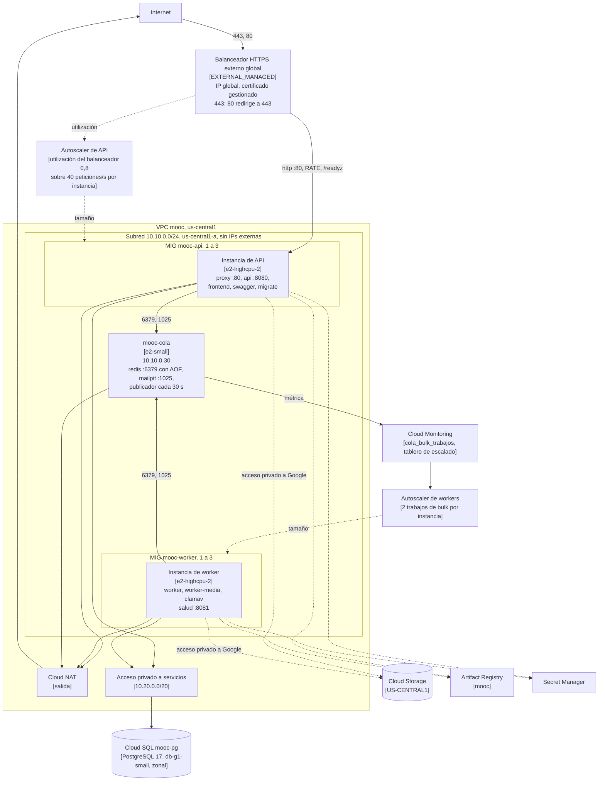

# Vista de despliegue — Entrega 3

Borrador de la sección de despliegue del informe de la Entrega 3. Sale de
`infra/environments/entrega3/` y de `deploy/compose.{web,worker,cola}.yml`.

## Vista de despliegue

El tráfico de los usuarios entra por el balanceador, que es la única dirección
pública del despliegue. El balanceador termina TLS con un certificado
gestionado para el nombre `<ip>.sslip.io` y redirige el puerto 80 al 443. Lo
reparte hacia el grupo `mooc-api` por el puerto nombrado `http` en modo
`RATE`, y solo manda tráfico a instancias que pasan `/readyz`. Esa ruta
comprueba la base, Redis y el almacenamiento de objetos. Una instancia sale
del reparto unos 15 s después de dejar de atender.

Cada instancia de API corre Caddy en el puerto 80. Caddy manda `/api/`,
`/healthz`, `/readyz` y `/openapi.yaml` a la API en el 8080 y `/docs` a
Swagger. Todo lo demás va al frontend. Al arrancar, el contenedor
`migrate` aplica las migraciones. Las réplicas se serializan entre sí, así
que nunca migran dos a la vez. Las instancias de worker corren `worker`,
`worker-media` y ClamAV, y no reciben tráfico de usuarios.

La máquina `mooc-cola` queda fuera de los grupos porque tiene estado. Tiene
la IP interna fija 10.10.0.30 y corre Redis, con persistencia AOF, para las
sesiones, la caché, el rate limiting y la cola asynq. También corre Mailpit
como servidor SMTP. Un temporizador de systemd publica cada 30 s, en Cloud
Monitoring, los trabajos de `bulk` pendientes más los que están en curso.

Cada grupo tiene su propio autoscaler, entre 1 y 3 instancias. El de API sigue
la utilización del balanceador, con un objetivo de 0,8 sobre 40 peticiones
por segundo por instancia, y por eso crece al pasar de unas 32. El de workers
divide la métrica `cola_bulk_trabajos` entre 2 trabajos por instancia. Además,
cada grupo se repara solo: si una instancia deja de responder a `/healthz`, se
recrea.

Ninguna máquina tiene IP externa. Salen a Internet por Cloud NAT para
descargar paquetes e imágenes públicas. Llegan a Cloud SQL por el acceso
privado a servicios, y a Cloud Storage, Artifact Registry y Secret Manager por
el acceso privado a Google de la subred. Los secretos los lee cada instancia
de Secret Manager al arrancar, con su propia cuenta de servicio. El generador
de carga, que no aparece en el diagrama, es una máquina aparte que solo existe
mientras se mide. Ataca la URL pública del balanceador.

| Recurso | Configuración |
| --- | --- |
| Región y zona | `us-central1`, `us-central1-a` para los grupos, la cola y la base |
| Grupos | `mooc-api` y `mooc-worker`, zonales, de 1 a 3 instancias `e2-highcpu-2` |
| Actualización | Reemplazo de una en una, con una instancia de más y ninguna de menos |
| Máquina de la cola | `mooc-cola`, `e2-small`, IP interna fija 10.10.0.30 |
| Contenedores de API | `proxy`, `api`, `frontend`, `swagger` y `migrate` al arrancar |
| Contenedores de worker | `worker`, `worker-media`, `clamav` |
| Contenedores de la cola | `redis` con AOF y `mailpit` |
| Base | PostgreSQL 17, `db-g1-small`, zonal, disco SSD, solo conexiones cifradas |

### Reglas de acceso

| Regla | Origen | Destino | Puertos |
| --- | --- | --- | --- |
| `mooc-lb-api` | Rangos del balanceador y de las verificaciones de Google | Cuenta de API | 80 |
| `mooc-salud-worker` | Rangos de las verificaciones de Google | Cuenta de worker | 8081 |
| `mooc-redis-interno` | Cuentas de API y de worker | Cuenta de la cola | 6379 |
| `mooc-smtp-interno` | Cuentas de API y de worker | Cuenta de la cola | 1025 |
| `mooc-ssh-iap` | Rango de IAP | Las tres cuentas | 22 |
| `mooc-denegar-resto` | Internet | Toda la VPC | Todo, con registro |
