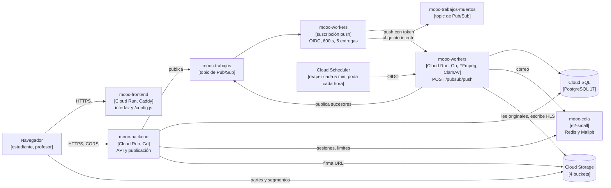
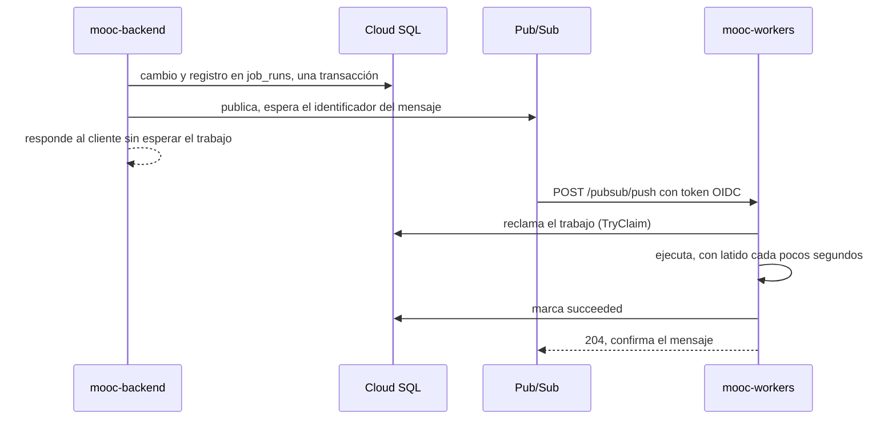
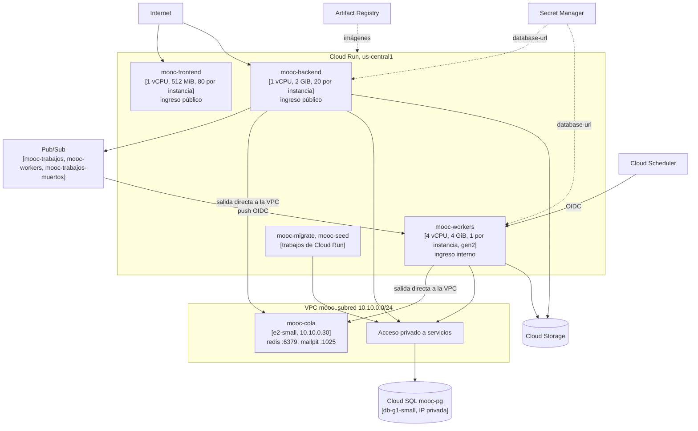

# Informe de arquitectura. Entrega 4

Santiago Chica Castano, Josue Briceño Urquijo, Daniel Alfredo Reales Paba y
Michael Javier Patiño Pantoja.

| Servicio | URL |
| --- | --- |
| Interfaz web | <https://mooc-frontend-568765476410.us-central1.run.app> |
| Documentación de la API | <https://mooc-frontend-568765476410.us-central1.run.app/docs/> |
| API | <https://mooc-backend-568765476410.us-central1.run.app> (`/api/v1`, `/openapi.yaml`) |

## Qué cambió desde la Entrega 3

Los dos grupos de instancias, el balanceador y los autoscalers dejan paso a tres
servicios de Cloud Run: frontend, backend y workers. La cola asynq sobre Redis
deja paso a un topic de Pub/Sub con una suscripción push autenticada hacia los
workers. El dominio no cambia. Cambian el adaptador que publica trabajos, el que
los recibe, el arranque de los procesos y la infraestructura. Redis sigue para
sesiones, caché y límites de tasa.

## 1. Introducción y objetivos

El objetivo es operar la plataforma sobre cómputo sin servidores, con cada
servicio escalando de forma independiente hasta tres instancias, y desacoplar
el backend de los workers con mensajería gestionada que confirme cada trabajo
solo cuando su resultado quedó persistido.

### Alcance de esta entrega

| Área | Qué se entrega |
| --- | --- |
| Cómputo | `mooc-frontend`, `mooc-backend` y `mooc-workers` en Cloud Run, de 0 a 3 instancias |
| Mensajería | Topic `mooc-trabajos`, suscripción push `mooc-workers` y topic de mensajes muertos |
| Acceso | Cuentas de servicio por papel, workers invocables solo por la suscripción y por Cloud Scheduler |
| Datos | Cloud SQL y Cloud Storage de las entregas anteriores, sin recrearse |
| Operación | Migraciones y semilla como trabajos de Cloud Run. Reaper y poda disparados por Cloud Scheduler |

### Contenido del documento

| Contenido | Sección |
| --- | --- |
| Componentes y flujo de una tarea | 5 y 6 |
| Despliegue y acceso | 7 |
| Confirmación, reentregas y configuración | 8 |
| Escalamiento observado | 10 |
| Riesgos | 11 |

La guía para reproducir el despliegue es [`despliegue.md`](despliegue.md). Las
evidencias están en [`evidencias/`](evidencias/README.md).

## 2. Restricciones

| Restricción | Consecuencia |
| --- | --- |
| Tres servicios independientes con máximo de 3 instancias | `max_instancias = 3`, validado en `infra/environments/entrega4/variables.tf` |
| Un contenedor de aplicación por instancia | `clamd` corre dentro del contenedor de workers, arrancado antes que el worker |
| Mensajería por Pub/Sub con push autenticado | Token OIDC de una cuenta dedicada, verificado por Cloud Run |
| Confirmar después de persistir | El worker responde 2xx solo cuando el trabajo quedó `succeeded` en la base |
| Réplicas sin almacenamiento local persistente | Estado en Cloud SQL, Cloud Storage y Redis |
| Secretos fuera del repositorio y las imágenes | Secret Manager, referenciado por Cloud Run |

## 3. Contexto y alcance

Estudiantes y profesores usan la interfaz web, que llama a la API en otro
origen. Los archivos viajan entre el navegador y Cloud Storage con URL firmadas.
El correo lo recibe Mailpit en `mooc-cola`, sin proveedor contratado.

## 4. Estrategia de solución

Los módulos publican trabajos por la interfaz `queue.Publicador`
(`backend/internal/adapters/queue/publicador.go`), con dos implementaciones.
asynq sobre Redis sigue en local y en el CI. Pub/Sub se usa en la nube. La
variable `QUEUE_BACKEND` elige una. El worker, con Pub/Sub, deja de consumir de
una cola y pasa a ser un servidor HTTP que recibe cada mensaje en
`POST /pubsub/push`. La idempotencia ya estaba en `platform.job_runs`
(ADR-0008) y no cambia. Cada servicio es una imagen de Artifact Registry
desplegada por Terraform desde `infra/environments/entrega4`, que heredó el
estado de la Entrega 3.

## 5. Vista de bloques

El frontend sirve la interfaz estática y `/config.js`, que le dice al navegador
la URL de la API. El backend responde CORS solo al origen del frontend
(`backend/internal/platform/httpx/cors.go`). La sesión viaja en
`Authorization`, sin cookies. Cada trabajo que termina puede publicar el
siguiente, como el escaneo que publica la transcodificación, así que los
workers también publican en el topic.

| Trabajo | Lo origina | Efecto |
| --- | --- | --- |
| `email.send` | Registro y recuperación de contraseña | Correo en Mailpit |
| `media.probe`, `media.scan`, `media.transcode_hls` | Confirmación de una carga | Archivo verificado, escaneado y en HLS |
| `badge.issue` | Inscripción aprobada | Insignia emitida una vez |

## 6. Vista de ejecución

### Una tarea por Pub/Sub

El 8 de noviembre una insignia recorrió este camino en 188 ms: «trabajo
publicado» en el backend a las 00:17:51.295 y «trabajo completado» en los
workers a las 00:17:51.483, con la misma `job_key` y el mismo `trace_id`
(`evidencias/reentrega-insignia.tsv`). El cliente consulta el resultado en el
recurso, como el estado de un archivo o la insignia de la inscripción.

### Respuestas del worker

| Situación | Respuesta | Qué hace Pub/Sub |
| --- | --- | --- |
| El trabajo terminó y quedó persistido | 204 | Confirma |
| La entrega repite un trabajo ya terminado | 204, sin ejecutarlo | Confirma |
| Otro worker lo tiene en curso | 409 | Reintenta. Si ese worker muere, el latido vence a los 90 s y la entrega siguiente lo reclama |
| El trabajo falló | 500 | Reintenta con espera de 10 a 600 s |
| Quinta entrega fallida | 500, después de marcar `dead` en la base | Manda el mensaje a `mooc-trabajos-muertos` |
| Mensaje ilegible o de tipo desconocido | 204 | Confirma, porque reintentarlo no lo arregla |

La lógica está en `backend/internal/adapters/queue/push.go` y `runner.go`, con
pruebas en `push_test.go`.

## 7. Vista de despliegue

Backend y workers salen a la VPC con salida directa (`PRIVATE_RANGES_ONLY`).
Así llegan a la IP privada de Cloud SQL y a Redis y Mailpit en `mooc-cola`. El
resto del tráfico, hacia Pub/Sub y Cloud Storage, sale por la red de Google.

| Servicio | Región | Mínimo | Máximo | CPU | Memoria | Concurrencia | Tiempo máximo |
| --- | --- | --- | --- | --- | --- | --- | --- |
| `mooc-frontend` | `us-central1` | 0 | 3 | 1 | 512 MiB | 80 | 30 s |
| `mooc-backend` | `us-central1` | 0 | 3 | 1 | 2 GiB | 20 | 60 s |
| `mooc-workers` | `us-central1` | 0 | 3 | 4 | 4 GiB | 1 | 600 s |

El backend tiene 2 GiB porque cada inicio de sesión reserva 64 MiB para
argon2id. Los workers procesan un trabajo a la vez porque FFmpeg ocupa todos
los núcleos, y tienen 4 vCPU para que un video del perfil C quepa en los 600 s
del plazo de confirmación (sección 10). Los tres servicios tienen la CPU
asignada siempre, también fuera de las peticiones.

### Identidades y acceso

| Identidad | Permisos |
| --- | --- |
| `mooc-web` (backend) | Publica en `mooc-trabajos`, lee `database-url`, firma URL sobre sí misma, objetos según bucket |
| `mooc-worker` (workers) | Publica en `mooc-trabajos`, lee `database-url`, objetos según bucket |
| `mooc-frontend` | Ningún permiso sobre datos. Solo sirve archivos estáticos |
| `mooc-pubsub-push` | `roles/run.invoker` sobre `mooc-workers`. Es la identidad del token de la suscripción |
| `mooc-programador` | `roles/run.invoker` sobre `mooc-workers`, para el reaper y la poda |
| Agente de servicio de Pub/Sub | Crea tokens de `mooc-pubsub-push`, publica en el topic de muertos y confirma en la suscripción |

Los workers tienen ingreso interno y solo esas dos cuentas pueden invocarlos.
Desde Internet responden 404. Frontend y backend son públicos porque son la
aplicación. Las políticas leídas del proyecto están en
`evidencias/pubsub-e-iam.yaml`.

| Regla de firewall | Origen | Destino | Puertos |
| --- | --- | --- | --- |
| `mooc-cloudrun-cola` | Subred de la salida directa | Cuenta de la cola | 6379 y 1025 |

## 8. Conceptos transversales

### Confirmación después de persistir

El worker reclama el trabajo en `platform.job_runs` con una actualización
atómica, lo ejecuta y lo marca `succeeded` antes de responder. Si el proceso
muere a mitad, no hay respuesta, Pub/Sub reintenta al vencer el plazo y la
entrega siguiente encuentra el latido vencido y reclama el trabajo. Una copia
de un trabajo terminado se confirma sin ejecutarse. El 8 de noviembre se
publicó a mano una copia de un `badge.issue` terminado. El worker respondió 204
en 9 ms, registró «entrega repetida de un trabajo terminado; se confirma sin
repetirlo» y no emitió una segunda insignia.

### Tiempos compatibles

| Parámetro | Valor |
| --- | --- |
| Plazo de confirmación de la suscripción | 600 s, el máximo de Pub/Sub para push |
| Tiempo máximo de solicitud de los workers | 600 s |
| Corte a los 600 s | Cloud Run cancela la petición, el worker marca el trabajo como fallido y Pub/Sub lo reintenta |
| Reintentos | Exponencial de 10 a 600 s |
| Entregas máximas | 5, después `mooc-trabajos-muertos` |

### Tareas periódicas

Cloud Run solo garantiza CPU mientras atiende una petición. El reaper, que
vuelve a publicar trabajos huérfanos, y la poda de registros vencidos son
peticiones de Cloud Scheduler a `POST /tareas/reaper` y `POST /tareas/podar`,
cada 5 minutos y cada hora. El reaper solo toca trabajos de más de 10 minutos,
para no duplicar los que Pub/Sub aún está reintentando.

### Migraciones y semilla

`mooc-migrate` y `mooc-seed` son trabajos de Cloud Run con la imagen de cada
uno. Corren una vez por despliegue, fuera de las réplicas. La semilla lee la
contraseña de las cuentas sintéticas de Secret Manager.

### Configuración y secretos

La configuración va en variables de entorno definidas en
`infra/environments/entrega4/cloudrun.tf`. La cadena de conexión a la base es
el único secreto de los servicios y Cloud Run la lee de Secret Manager. Las
imágenes no llevan credenciales. Nadie crea claves JSON de cuentas de servicio
(ADR-0015, D3).

### Interfaz en otro origen

El frontend recibe la URL de la API por la variable `API_URL`, que Caddy
publica en `/config.js`. La API firma las URL de los archivos y de los
manifiestos HLS con `PUBLIC_BASE_URL`, que es la URL del backend. El contenido
de un archivo se pide con `Accept: application/json` y la API devuelve la URL
firmada en el cuerpo, porque un navegador manda `Origin: null` cuando una
redirección cruza a otro origen.

### Rutas reservadas

Cloud Run reserva las rutas públicas que terminan en `z`, como `/healthz`. La
verificación pública es `/readyz`. `/healthz` sigue sirviendo a la sonda de
arranque de los workers, que es interna.

## 9. Decisiones de arquitectura

| Decisión | Motivo | Registro |
| --- | --- | --- |
| Dos transportes detrás de una interfaz | El dominio no cambia y el stack local sigue probando todo en segundos | ADR-0020, D1 |
| Push con 204, 409 y 500 según el estado del trabajo | Confirmar solo lo persistido y no perder lo que otro worker dejó a medias | ADR-0020, D2 |
| Plazo de 600 s, cinco entregas y topic de muertos | Un trabajo que no termina queda `dead` en la base y en un topic revisable | ADR-0020, D3 |
| Un servicio de workers con FFmpeg y ClamAV | Un contenedor por instancia, con las firmas en la imagen | ADR-0020, D4 |
| Workers internos e invocables por dos cuentas | Nadie más puede ejecutar trabajos | ADR-0020, D5 |
| Redis en `mooc-cola` por salida directa a la VPC | Pub/Sub sustituye la mensajería, no las sesiones ni los límites | ADR-0020, D6 |
| Cliente oficial `cloud.google.com/go/pubsub/v2` | Lotes, reintentos y credenciales del entorno | ADR-0020, D7 y ADR-0002 |
| Entorno `entrega4` que hereda el estado | La base, los buckets y los secretos no se recrean | Alcance, D11 |

## 10. Requisitos de calidad

### Funcionamiento

| Prueba | Resultado |
| --- | --- |
| Colección de Postman contra el backend | 72 peticiones, 146 aserciones, 0 fallos |
| Recorrido de navegador contra el frontend | Pasa, con video HLS y archivo en otro origen |
| Prueba local con el emulador de Pub/Sub (`make prueba-pubsub`) | Pasa, con la reentrega de un trabajo terminado |

### Escalamiento observado

Las cifras salen de Cloud Monitoring con `make escalado-cloudrun`. Las tablas
completas están en `evidencias/escalado-backend.md` y
`evidencias/escalado-workers.md`.

Con 600 lecturas por segundo del catálogo, el backend pasó de 1 a 2 instancias
en un minuto y a 3 en cinco. La CPU llegó al 73 % con dos y bajó al 33 % con
tres. La latencia dentro del servidor fue de 3 ms de mediana. Una fase de 1.500
peticiones por segundo no sumó más instancias, porque el máximo es 3.

Con cinco videos del perfil C subidos a la vez, los workers pasaron de 1 a 3
instancias en un minuto, con la CPU al 100 %. Hasta 7 mensajes esperaron en la
suscripción. Los cinco videos quedaron listos en 29 minutos.

Esa prueba encontró un defecto de dimensionamiento. Con 2 vCPU, un video del
perfil C tardó 519 s en Cloud Run y otros dos llegaron a los 600 s y se
cortaron. En la máquina virtual de 2 vCPU de la Entrega 2, el mismo video
tardaba 196 s. Con 4 vCPU las transcodificaciones siguientes tardaron de 286 a
437 s. Los trabajos cortados volvieron a la cola y terminaron una sola vez.

## 11. Riesgos y deuda técnica

| Riesgo | Efecto | Mitigación |
| --- | --- | --- |
| Un video más largo que el perfil C | La transcodificación supera los 600 s y agota sus cinco entregas | Límite de duración en la carga, o transcodificar por segmentos en trabajos más cortos |
| Margen de 437 s sobre 600 s | Una instancia más lenta puede cortar un video del perfil C | Medir más corridas antes de aceptar videos de más de 2 minutos |
| Mensajes rechazados por falta de instancia | Pub/Sub espera hasta 600 s antes de reintentar y la cola tarda más en vaciarse | Es el comportamiento esperado con máximo 3. El reaper republica lo que pasa de 10 minutos |
| `mooc-cola` es una sola máquina | Sin ella no hay sesiones, límites ni correo | Heredado de la Entrega 3. Memorystore la sustituiría con costo mayor |
| Cloud SQL zonal | Una caída de la zona detiene la plataforma | Fuera del alcance de la entrega |

`make psql-nube` entraba a la base desde una máquina de API de la Entrega 3, que
ya no existe. Queda sin sustituto en esta entrega.

## 12. Glosario

| Término | Significado |
| --- | --- |
| Push | Modo de Pub/Sub en el que el servicio recibe cada mensaje como una petición HTTP |
| Confirmación | Respuesta 2xx que le dice a Pub/Sub que no reintente |
| Plazo de confirmación | Tiempo que Pub/Sub espera la confirmación antes de reintentar |
| Topic de muertos | Topic al que van los mensajes que agotaron sus entregas |
| OIDC | Token firmado que identifica a la cuenta que invoca un servicio |
| Salida directa a la VPC | Conexión de Cloud Run a direcciones privadas de la VPC sin conector |
| Revisión | Versión inmutable de un servicio de Cloud Run |
