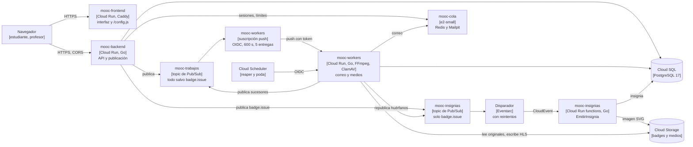
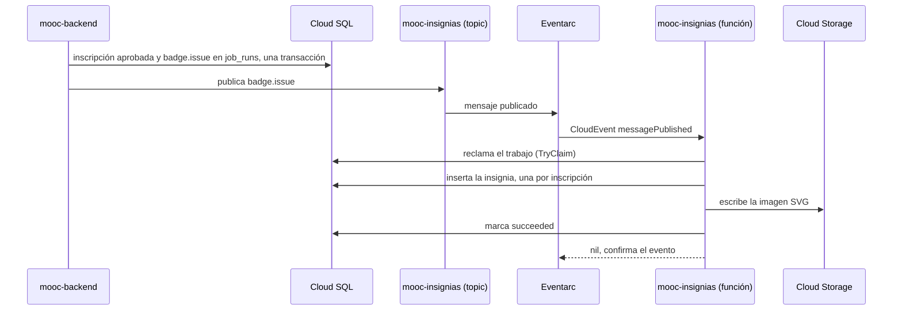
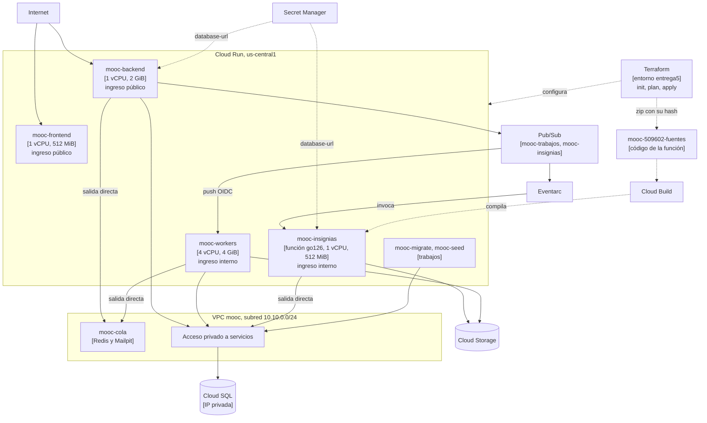

# Informe de arquitectura. Entrega 5

Santiago Chica Castano, Josue Briceño Urquijo, Daniel Alfredo Reales Paba y
Michael Javier Patiño Pantoja.

| Servicio | URL |
| --- | --- |
| Interfaz web | <https://mooc-frontend-568765476410.us-central1.run.app> |
| Documentación de la API | <https://mooc-frontend-568765476410.us-central1.run.app/docs/> |
| API | <https://mooc-backend-568765476410.us-central1.run.app> (`/api/v1`, `/openapi.yaml`) |

## Qué cambió desde la Entrega 4

La emisión de insignias sale del worker y pasa a una Cloud Run function de
segunda generación, `mooc-insignias`. El backend la publica en un topic propio,
`mooc-insignias`, y Eventarc se la entrega a la función. El worker deja de
atender ese tipo de trabajo. El resto de la arquitectura no cambia.

Todo el despliegue, incluidos la función, su código y su disparador, se hace
con `terraform init`, `plan` y `apply` desde el entorno
`infra/environments/entrega5`. Las migraciones de la base, que antes se
ejecutaban a mano, corren ahora dentro del `apply`.

## 1. Introducción y objetivos

El objetivo es llevar a un servicio serverless una tarea del worker sin cambiar
su resultado, y que una persona pueda desplegar y actualizar la arquitectura
completa solo con Terraform.

### Alcance de esta entrega

| Área | Qué se entrega |
| --- | --- |
| Análisis | Componentes serverless y oportunidades, en [`analisis-serverless.md`](analisis-serverless.md) |
| Migración | `badge.issue` en la función `mooc-insignias`, activada por Pub/Sub mediante Eventarc |
| Integración | Enrutamiento por tipo de trabajo, con el worker fuera de la tarea migrada |
| Terraform | Cloud Run, Pub/Sub, la función con su código y su disparador, identidades, permisos y secretos |
| Despliegue | Guía reproducible en [`despliegue.md`](despliegue.md) |

### Contenido del documento

| Contenido | Sección |
| --- | --- |
| La función y sus conexiones | 5 y 7 |
| El recorrido de una insignia | 6 |
| Terraform, reintentos y enrutamiento | 8 |
| Verificación | 10 |
| Riesgos | 11 |

## 2. Restricciones

| Restricción | Consecuencia |
| --- | --- |
| La tarea migrada corre en una Cloud Run function de segunda generación activada por Pub/Sub | Disparador de Eventarc sobre `mooc-insignias` |
| Se conservan el comportamiento y el resultado de la tarea | La función usa el mismo servicio y el mismo ejecutor que el worker |
| El worker deja de ejecutar la tarea migrada | Topic propio y manejador retirado del worker |
| Reintentos sin duplicar efectos | El reclamo atómico en `platform.job_runs` también protege a la función |
| Despliegue solo con `init`, `plan` y `apply` | Terraform gestiona el código de la función y ejecuta las migraciones |
| Sin credenciales, secretos ni estado en el repositorio | Secretos generados por Terraform en Secret Manager y estado en un bucket con versionado |

## 3. Contexto y alcance

Sin cambios desde la Entrega 4. Estudiantes y profesores usan la interfaz web,
que llama a la API en otro origen, y los archivos viajan entre el navegador y
Cloud Storage con URL firmadas.

## 4. Estrategia de solución

La función no reimplementa la tarea. Es un punto de entrada nuevo
(`backend/funcion.go`) sobre el mismo código del backend. Recibe el CloudEvent,
extrae el mensaje de Pub/Sub y se lo pasa al ejecutor `queue.Runner`, que
reclama el trabajo, llama a `badges.Service` y anota el resultado, igual que en
el worker. El adaptador de Pub/Sub enruta cada tipo de trabajo a su topic según
`PUBSUB_TOPICOS`, así que los módulos que publican no cambian. El entorno de
Terraform `entrega5` heredó el estado de `entrega4` y solo añadió lo nuevo.

## 5. Vista de bloques

El backend publica cada trabajo en el topic de su tipo. `badge.issue` va a
`mooc-insignias` y Eventarc lo entrega a la función, que escribe la insignia en
Cloud SQL y su imagen en Cloud Storage. Los demás tipos siguen el camino de la
Entrega 4 hacia el worker. El reaper de los workers republica por el mismo
adaptador, así que una insignia huérfana vuelve a `mooc-insignias` y no al
worker.

| Trabajo | Topic | Lo ejecuta |
| --- | --- | --- |
| `badge.issue` | `mooc-insignias` | La función `mooc-insignias` |
| `email.send` | `mooc-trabajos` | `mooc-workers` |
| `media.probe`, `media.scan`, `media.transcode_hls` | `mooc-trabajos` | `mooc-workers` |

## 6. Vista de ejecución

### Una insignia

El 21 de noviembre una insignia hizo este recorrido en la nube
(`evidencias/tarea-y-reentrega.tsv`).

| UTC | Servicio | Registro |
| --- | --- | --- |
| 23:54:05.336 | `mooc-backend` | trabajo publicado, en `mooc-insignias` |
| 23:54:06.826 | `mooc-insignias` | trabajo iniciado |
| 23:54:07.036 | `mooc-insignias` | trabajo completado |
| 23:55:17.060 | `mooc-insignias` | entrega repetida de un trabajo terminado. Se confirma sin repetirlo |

La última fila es una copia del mismo trabajo, publicada a mano en el topic.
Eventarc la entregó y la función la confirmó sin ejecutarla.

### Respuestas de la función

| Situación | La función devuelve | Eventarc |
| --- | --- | --- |
| El trabajo terminó y quedó persistido | `nil` | Confirma |
| La entrega repite un trabajo ya terminado | `nil`, sin ejecutarlo | Confirma |
| Otro lo tiene en curso | Error | Reintenta con espera exponencial |
| Falló, con menos de cinco reclamos | Error | Reintenta |
| Falló en el quinto reclamo | `nil`, después de marcar `dead` | Confirma y deja de reintentar |
| Evento ilegible o de otro tipo | `nil` | Confirma, porque reintentarlo no lo arregla |

La lógica está en `backend/internal/adapters/queue/evento.go`, con pruebas en
`evento_test.go`.

## 7. Vista de despliegue

La función llega a Cloud SQL por su IP privada con salida directa a la VPC, en
la misma subred que los servicios. No hay conector. Terraform empaqueta el
código del backend, lo sube a `mooc-509602-fuentes` con su hash en el nombre, y
Cloud Build lo compila con el runtime `go126`.

| Servicio | Región | Mínimo | Máximo | CPU | Memoria | Concurrencia | Tiempo máximo | Ingreso |
| --- | --- | --- | --- | --- | --- | --- | --- | --- |
| `mooc-frontend` | `us-central1` | 0 | 3 | 1 | 512 MiB | 80 | 30 s | Público |
| `mooc-backend` | `us-central1` | 0 | 3 | 1 | 2 GiB | 20 | 60 s | Público |
| `mooc-workers` | `us-central1` | 0 | 3 | 4 | 4 GiB | 1 | 600 s | Interno |
| `mooc-insignias` (función) | `us-central1` | 0 | 3 | 1 | 512 MiB | 1 | 60 s | Interno |

### Identidades y acceso

| Identidad | Permisos |
| --- | --- |
| `mooc-web` (backend) | Publica en `mooc-trabajos` y `mooc-insignias`, lee `database-url`, firma URL sobre sí misma, objetos según bucket |
| `mooc-worker` (workers) | Publica en los dos topics, lee `database-url`, objetos según bucket |
| `mooc-insignias` (función) | Lee `database-url` y escribe objetos en el bucket `badges`. Nada más |
| `mooc-eventarc` (disparador) | Recibe eventos y `roles/run.invoker` solo sobre la función |
| `mooc-compilacion` (Cloud Build) | Escribe registros y en Artifact Registry, y lee el código de la función. El permiso de lectura del bucket interno de Cloud Run functions está limitado por condición a los buckets `gcf-v2-sources-*` |
| `mooc-frontend` | Ningún permiso sobre datos |
| `mooc-pubsub-push` y `mooc-programador` | `roles/run.invoker` sobre `mooc-workers` |

La función tiene ingreso interno y solo el disparador puede invocarla. La
compilación no usa la cuenta de Compute Engine por omisión, que tiene permisos
de editor.

## 8. Conceptos transversales

### Enrutamiento por tipo

`PUBSUB_TOPICOS=badge.issue=mooc-insignias` en el backend y los workers. El
adaptador de Pub/Sub abre un publicador por topic y elige el del tipo de cada
trabajo. El worker, al arrancar con Pub/Sub, retira de sus manejadores los
tipos que tienen otro topic. En local y en el CI no se define, y la cola de
asynq atiende todos los tipos como antes.

### Reintentos y límite

El disparador reintenta con espera exponencial y el evento no trae el número
de entrega. La función lo toma de `platform.job_runs.attempt`, que sube en cada
reclamo, y al quinto fallo marca el trabajo `dead` y confirma el evento. Es el
mismo límite de cinco que tienen los workers con el `deliveryAttempt` de
Pub/Sub. Una copia de un trabajo terminado no se ejecuta en ninguno de los dos
caminos, porque el reclamo atómico la rechaza.

### Infraestructura como código

| Práctica | Dónde |
| --- | --- |
| Un entorno por entrega, que hereda el estado del anterior y lo congela | `infra/environments/entrega5`, `make tf` rechaza `entrega4` |
| Código de la función empaquetado y versionado por su hash | `archive_file` y `google_storage_bucket_object.funcion` en `funcion.tf` |
| Migraciones dentro del `apply` | `run_execution_token` en `google_cloud_run_v2_job.migrate` |
| Semilla solo cuando se pide | `run_execution_token = var.ejecutar_semilla` |
| Cada revisión dice qué código corre | Etiqueta `version` en la plantilla de cada servicio |
| Servicios y trabajos esperan a la base | `depends_on = [module.cloudsql]` |
| Parámetros del entorno | `terraform.tfvars` versionado y `privado.auto.tfvars` fuera del repositorio |
| Versiones fijas de Terraform y proveedores | `infra/versions.tf`, enlazado desde cada entorno |

### Secretos y estado

Terraform genera la contraseña de la base y la de las cuentas sintéticas como
valores efímeros y las escribe directo en Secret Manager, así que no aparecen
en el plan ni en el estado. Los servicios y la función reciben `database-url`
por referencia. El estado vive en `gs://mooc-tfstate-mooc-509602`, con
versionado. Ninguna persona creó claves JSON de cuentas de servicio.

### Ruta del módulo de Go

El buildpack de Go de Cloud Run functions exige un punto en el primer elemento
de la ruta del módulo, así que el módulo pasó de `mooc/backend` a
`mooc.local/backend`. Cambiaron los imports y nada más.

## 9. Decisiones de arquitectura

| Decisión | Motivo | Registro |
| --- | --- | --- |
| Migrar `badge.issue` | Usa Cloud SQL y Cloud Storage, es corta, no necesita binarios y su duplicado se vería | ADR-0021, D1 |
| Un topic por consumidor | El worker deja de recibir la tarea por construcción | ADR-0021, D2 |
| Reutilizar el ejecutor y el servicio | Mismo comportamiento y resultado | ADR-0021, D3 |
| Límite de intentos contado en la base | El evento no trae el número de entrega | ADR-0021, D4 |
| Código desplegado por Terraform desde el módulo del backend | Terraform gestiona el código desplegable | ADR-0021, D5 |
| Salida directa a la VPC, sin conector | Llega a la IP privada de Cloud SQL sin costo fijo | ADR-0021, D6 |
| `functions-framework-go` y `cloudevents` | Las exige el runtime de Go | ADR-0021, D7 y ADR-0002 |

## 10. Requisitos de calidad

| Prueba | Resultado |
| --- | --- |
| `make prueba-funcion`, en local con el emulador de Pub/Sub | Pasa. 56 peticiones y 114 aserciones, la función emite la insignia, una segunda entrega se confirma sin repetirla y el worker no atiende `badge.issue` |
| `make postman-nube`, contra el despliegue | 72 peticiones, 146 aserciones, 0 fallos, hasta la insignia |
| La insignia en la nube | Publicada en `mooc-insignias` y emitida por la función. El worker no aparece |
| Reentrega en la nube | Confirmada sin repetir el trabajo |
| `terraform plan -detailed-exitcode` después del despliegue | «No changes», salida 0 |
| `make ci` | En verde |

Las evidencias están en [`evidencias/`](evidencias/README.md).

## 11. Riesgos y deuda técnica

| Riesgo | Efecto | Mitigación |
| --- | --- | --- |
| Arranque en frío de la función | La primera insignia tras un rato sin uso tarda más | Es una tarea asíncrona. Nadie espera la respuesta |
| Cada cambio del módulo `backend/` redespliega la función | Despliegues de la función que no tocan las insignias | Es el precio de compartir el código. El `plan` lo muestra |
| Dos caminos de reintento | Hay que mantener la suscripción push y el disparador | Los dos terminan en el mismo límite, contado en la base |
| Eventarc reintenta, por omisión, durante días | Un trabajo que falla siempre gasta invocaciones | La función corta al quinto reclamo |
| Las imágenes desplegadas se construyeron antes de renombrar el módulo | Ninguno. El código es el mismo | La próxima publicación ya lleva la ruta nueva |
| `mooc-cola` y Cloud SQL zonal | Puntos únicos de falla, heredados | Oportunidades O7 y O11 del análisis |

El análisis de SonarQube de esta entrega no se ha corrido. La línea base sigue
siendo la de la Entrega 4, con siete hallazgos abiertos.

## 12. Glosario

| Término | Significado |
| --- | --- |
| Cloud Run functions | Funciones de segunda generación de Google Cloud, que corren sobre Cloud Run |
| Eventarc | Servicio que entrega eventos, como un mensaje publicado en un topic, a una función o un servicio |
| CloudEvent | Formato estándar del evento que recibe la función |
| Disparador | Configuración de Eventarc que une un topic con la función |
| Buildpack | Proceso de Google que compila el código fuente de la función en una imagen |
| Arranque en frío | Primera petición de una instancia nueva, que incluye su arranque |
| `run_execution_token` | Valor de un trabajo de Cloud Run que, al cambiar, hace que Terraform lo ejecute en el `apply` |
